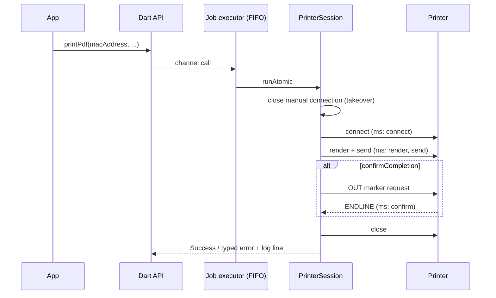

# Design

## Context

Today `PrinterSession` holds one global connection. `open`, `runJob` and `closePort` run on the plugin's single-thread executor, but each is a separate channel call, so another job's `open` can slip between a job's steps and close its connection. `PrinterSession.exclusive` only sets flags (`busy`, `cancelRequested`); it is not a lock. `cancel()` runs on the main thread and aborts whatever call is running. See proposal.md - Why.

## Goals / Non-Goals

**Goals:**
- One native unit per job (connect, render, send, confirm, close) in a FIFO queue.
- Same channel method names; new optional arguments added together in Dart interface, method channel and Kotlin.
- A one-line phase log, testable on the JVM.

**Non-Goals:**
- Changing the three-step API, defaults, or label sizes.
- Returning timings to Dart.

## Decisions

- **Queue by reusing the existing single-thread executor.** Atomic calls are posted with `executeInBackground`, so FIFO order and "never on the main thread" come for free; each atomic call is one task. Alternative: a second queue class (discarded: two orderings to reason about).
- **New method `PrinterSession.runAtomic(macAddress, connectTimeoutMs, confirmCompletion, limits, phases, send)`.** It closes any connection left open by hand (takeover), opens a fresh connection via `newConnection`, runs `send`, then either awaits the `OUT` marker (`confirmCompletion` true) or, without waiting for the marker, waits the close-grace delay and closes (false), and closes on every path. Alternative: compose `open` + `runJob` (discarded: they run as separate `exclusive` blocks, so a cancel arriving between them would hit the gap).
- **Scoped cancel.** `cancelRequested` is reset at the start of each `runAtomic`, as `exclusive` already does, so a cancel only affects the call that is running; queued calls start with a clean flag. A cancel that arrives while nothing runs does nothing (`busy` guard), which also keeps queued calls alive.
- **Phase timing in a plain Kotlin class `PhaseTimer`** with an injectable clock. It records connect, render, send and confirm milliseconds and formats one line without MAC addresses or PINs. `PrinterFlutterPlugin` logs the line with `Log.i` when the atomic call ends. The render phase is measured inside the `send` lambda for `printPdf` (a `PhaseTimer` is passed in); for TSPL/raw it is 0.
- **`confirmCompletion=false` on the three-step API.** `runJob` gains a `confirmCompletion` parameter (default `true`). With `closePort` true and it false, `runJob` sleeps `closeGraceMs` and closes instead of awaiting the marker.
- **Dart side.** `printPdf`, `sendTspl`, `sendRawBytes` get optional `macAddress`, `pin`, `fallbackPin`, `connectTimeout` and `confirmCompletion` in `printer_flutter.dart`, the platform interface and the method channel. The channel sends the new keys only when set, so existing argument maps do not change. Channel keys: `macAddress`, `pin`, `fallbackPin`, `connectTimeoutMs`, `confirmCompletion`. Kotlin reads them with the same names as `openPort` already uses.

## Risks / Trade-offs

- [A cancel racing with a queued call starting] → the flag is reset only when a call starts, and `cancel()` is a no-op when nothing is running; covered by a JVM test with a fake transport.
- [Mixing the two styles] → documented as "do not mix"; an atomic call closes a manual connection.
- [Timeout means "not confirmed"] → documented in README and `///` comments (D16).

## Assumptions

- The issue's "`GLOSSARY.md`, under its existing heading" is taken literally, but `GLOSSARY.md` does not exist in the repository. The documentation task creates it with a `# Glossary` heading and the four entries exactly as given.
- `docs/adr/` has `0001-...md`; the new ADR is `0002-printing-is-done-with-an-atomic-native-call.md`, with the heading `# 2. <title>` like the existing one, and the text exactly as given in the issue (in English).
- The existing channel key for the connect timeout is `connectTimeoutMs` (as used by `openPort`); the atomic call reuses it.
- `completionTimeout` and write timeout keep their existing arguments and defaults.
- With `confirmCompletion: false`, the atomic call still waits the existing close-grace delay (`CLOSE_GRACE_MS`) before closing, as `closePort` does, so the last bytes reach the printer; it does not write the completion request or wait for the marker. The README says so.
- The profile `analyze` command (`flutter analyze --no-pub`) exits 1 on two existing `info` diagnostics in `example/` (deprecated `material.dart` import on Flutter 3.50), while CI runs `flutter analyze --no-fatal-infos`. A file-level `// ignore_for_file: deprecated_member_use` in `example/lib/main.dart` and `example/test/widget_test.dart` is accepted in this change so the validation gate is green; migrating the import is a separate change.
## From the issue: Decisions

### D2. Measure before optimizing
Decided: speed work waits for per-phase numbers.
Why: on the RT-320 PB a new connection takes 2 to 5 s of a one-copy ticket of about 5.5 s, while a 72 x 240 mm ticket with 2 copies takes 18.5 s and nobody knows which phase takes it.
Discarded: optimizing bytes first (on short tickets the connection dominates).

### D3. A job is one atomic native call
Decided: a job is one native call in a queue instead of three calls on a global connection.
Why: the three steps could interleave and close each other's connection.
Discarded: a queue only in Dart (other instances or isolates skip it).

### D4. Reliability first, speed afterwards
Decided: this change is reliability; speed is a later change.
Why: speed work needs the phase log this change adds.
Discarded: both at once.

### D5. `macAddress` is optional on the existing calls
Decided: `printPdf`, `sendTspl` and `sendRawBytes` gain optional `macAddress`, `pin`, `fallbackPin` and `connectTimeout`, added together to the platform interface, the method channel and Kotlin.
Why: no new method names and nothing breaks.
Discarded: new methods.

### D11. `confirmCompletion` option
Decided: defaults to `true`; `false` skips the wait for the completion confirmation.
Why: a printer that never answers `OUT` prints but reports a timeout, and the user reprints.
Discarded: automatic detection only.

### D13. Minor version, no bump here
Decided: additive change (0.2.0 candidate), with an entry in `CHANGELOG.md` under "Unreleased"; the version is bumped only by the release.
Why: defaults do not change.
Discarded: bumping the version here.

### D14. Queue and takeover
Decided: atomic calls run first-in-first-out on their own connections; an atomic call closes a connection left open by hand; `cancel()` affects only the running call. Documented as "do not mix the two styles".
Why: `openPort` already closes the previous connection.
Discarded: rejecting with a "busy" error.

### D15. How it is tested
Decided: new logic in plain Kotlin classes tested on the JVM with fake transports, like `PrinterSessionTest`; Dart channel tests for the new arguments; what cannot be unit tested is verified by hand on the RT-320 PB.
Why: project rule.
Discarded: manual tests only.

### D16. What the completion confirmation means
Decided: the README, the `///` comments and `PrinterLimits.completionTimeout` say the confirmation means the printer processed everything it was sent, not that it finished printing; no `EOJ` is added.
Why: without `EOJ` the printer moves on without waiting for the print to end, and the firmware support of `EOJ` on the RT-320 PB is unknown.
Discarded: adding `EOJ` by default.

### D19. Phase timing in the log
Decided: the atomic call logs the milliseconds of each phase; the API does not change.
Why: D2.
Discarded: returning the times to Dart (API change).

## From the issue: Constraints

- C1: Defaults do not change silently; 58 mm, 72 mm, 80 mm and custom paper widths keep working.
- C2: Sockets and streams are closed on every path, and nothing blocks the main thread.
- C3: Every behaviour change adds or updates a test; a Kotlin change that cannot be unit tested says how it was verified.
- C4: No secrets or device MAC addresses in code, tests, logs or examples.

## From the issue: Code pointers

- `lib/printer_flutter.dart`: public API and `PrinterLimits`.
- `lib/printer_flutter_method_channel.dart`: channel arguments to keep in sync with Kotlin.
- `android/src/main/kotlin/com/urbanconnections/printer_flutter/PrinterFlutterPlugin.kt`: `onMethodCall` and the single-thread executor.
- `android/src/main/kotlin/com/urbanconnections/printer_flutter/PrinterSession.kt`: `open`, `runJob`, `closePort`; `exclusive` only sets flags, it is not a lock.
- `android/src/test/kotlin/com/urbanconnections/printer_flutter/PrinterSessionTest.kt`: fake-transport tests to extend.

## From the issue: Verification

- On the RT-320 PB, print with `macAddress` and `confirmCompletion` true and false; it prints once and the connection closes.
- Tap print twice quickly: both jobs print in order, with no `notConnected`.
- Print the 72 x 240 mm ticket with 2 copies and copy the phase log line into the pull request.

## Documentation from the issue

- Add these entries to `GLOSSARY.md`, under its existing heading, after the existing ones, exactly as written. They are vocabulary only; nothing else in that file changes.

**Job**:
One complete print, from opening the connection to confirming and closing it.
_Avoid_: call, command

**Atomic call**:
The way of printing that receives `macAddress` and does the whole job in one call.
_Avoid_: simple mode

**Completion confirmation**:
The `OUT` answer that says the printer processed everything it was sent.
_Avoid_: ACK, printed

**Not confirmed**:
A timeout after everything was sent: the printer did not confirm it processed the job, and it may still have printed.
_Avoid_: failed

- Add this decision record to `docs/adr/`, with no number (it is numbered when it is written):

**Printing is done with an atomic native call**

A print job was three calls on a global connection, and two quick taps could close each other's connection. An optional `macAddress` is added to the print calls so the whole job is one native unit in a queue. A queue only in Dart was discarded because other instances or isolates would skip it. The three-step API stays so nobody breaks.

Related: #1
